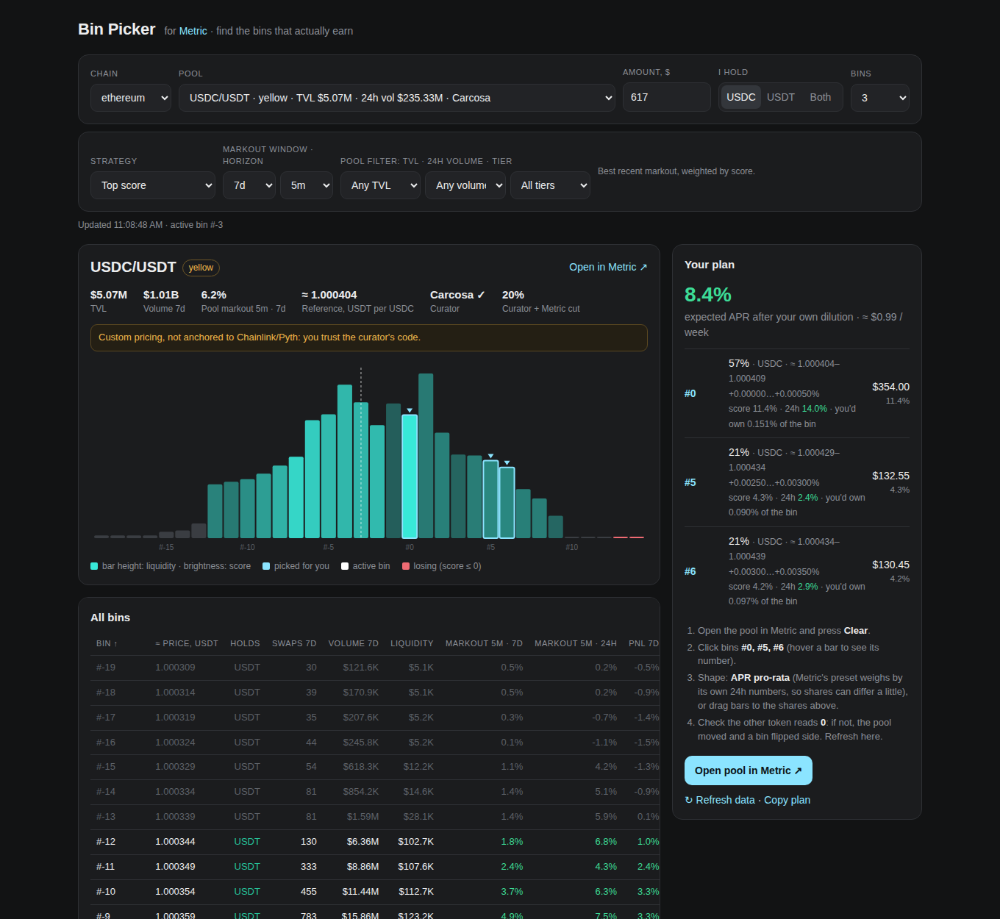

# Bin Picker for Metric

[](../../actions/workflows/ci.yml)

**Which bins should I put my liquidity in?** Pick a [Metric](https://app.metric.xyz) pool, the token you hold and how much.
Bin Picker ranks every bin you can fund by how much it actually earned, drops the ones that lose money, sit idle or are too
thin to trust, and tells you which bins to click and how to split.

**Live:** `https://<your-github-user>.github.io/metric-bin-picker/` · read-only, no wallet connection, no sign-up.



## Use it in three steps

1. Choose the chain and pool (filter by TVL, 24h volume and tier), type the amount and pick the token you hold.
2. Choose a strategy and the markout window and horizon, the same settings as in the Metric app.
3. Open the pool in Metric, press **Clear**, click the bins from the plan and use the shape it suggests.
   If the other token does not read 0, the pool moved: refresh the plan.

Every plan is a link (`?chain=1&pool=0x…&amt=1000&have=token0&s=curve&w=30d&h=1m`), so you can share it or bookmark it.

## What it shows

- **Your plan:** the bins, the amount for each, the approximate price range each bin covers, the part of the bin you would own,
  and the APR you can expect after your own deposit dilutes the bin.
- **Pool card:** tier and its reasons, curator, the curator's and Metric's cut, reference price, and warnings: custom pricing,
  feed down, paused pool, a pool idle for 24h.
- **All bins:** a sortable table and chart with swaps, volume, liquidity, markout over the window and the last 24h, trading PnL
  and the score.
- **How to read these numbers:** markout APR vs trading PnL, with a live example from the pool you picked.

## Strategies

| Strategy | Picks | Splits | When |
|---|---|---|---|
| Top score | best-scoring bins | in proportion to score | default |
| Max APR | best-scoring bins | water-fill by APR after your own dilution | large deposits next to thin bins |
| Flat | best-scoring bins | equally | simple, close to Metric's Flat |
| Volume pro-rata | best-scoring bins | by the volume that crossed them | follow the flow |
| Spot | closest earning bins to the price | equally | most trades, flips side most |
| Curve | closest earning bins | most weight next to the price | you expect the price to stay put |
| Bid-Ask | closest earning bins | most weight on the far bins | you expect bigger swings |

Losing, stale and thin bins are never picked, whatever the strategy.

## How bins are scored

For the window you pick (24h, 7d, 30d, All) and horizon (1m, 5m, 30m):

- **score** = 0.6 × markout APR over the window + 0.4 × markout APR over the last 24h, minus ¼ of a negative trading-PnL APR.
  With the 24h window the score is the 24h markout alone.
- A bin is skipped when it **lost money over the window**, had **too few swaps** (15 for 24h, 100 for 7d, 300 for 30d and All),
  **no swaps in the last 24h** (unless the whole pool was idle, e.g. a closed stock market), or **too little liquidity** for its
  APR to mean anything (under $1,000 or 2% of the largest bin).
- Only bins you can fund are offered: above the active bin they take token0, below it token1. The active bin and the bin next to
  it are skipped, because the pool moves while you click and they flip sides.
- Your deposit dilutes a bin: `x` dollars added to a bin holding `L` earn `score × L / (L + x)`.
- Prices are approximate: the reference is estimated from the pool's executable bid and ask, accurate to about half a bin.

Markout is a past measurement, not a forecast. Read the pool's tier and warnings before depositing.

## Built from #feedback

| Asked in Metric's #feedback | In Bin Picker |
|---|---|
| Bin strategies like spot / curve / bid-ask, with a hint when to use each | seven strategies with one-line hints |
| How do APR pro-rata and Volume pro-rata work? | the plan says which Metric preset matches each strategy |
| "The price each bin represents"; full range on hover | approximate price range per bin |
| Filters for minimum TVL and 24h volume | pool filter: TVL, 24h volume, tier |
| "Your deposit would be 3% of the pool" | the part of each bin you would own |
| Markout vs trading PnL is confusing | explainer with a live example |

## Data

| Endpoint | Used for |
|---|---|
| `GET /public/v1/chains` | chain list |
| `GET /public/v1/evm/{chain}/metadata` | pools, tier, curator, fees, pool markout |
| `GET /public/v1/evm/{chain}/{pool}/bid_ask?depth=false` | reference price estimate |
| `GET /public/v1/evm/{chain}/{pool}/analytics/bins?period=24h\|7d\|30d\|all&fiat=USD` | per-bin swaps, volume, liquidity, markout, trading PnL |

The per-bin endpoint is the one the Metric app itself uses. It is public (no key, CORS `*`) but not in the API docs, so it may
change; the daily CI run against live pools is there to catch that.

## Safety

Bin Picker only reads public data. It never connects a wallet, asks for a signature, stores keys or tracks you. Deposits happen
in the Metric app, where you check what you sign.

## Develop

```bash
npm start           # http://127.0.0.1:8765
npm test            # offline: core scoring + 24 user scenarios
npm run test:live   # every window × horizon × strategy on live pools
npm run test:ui     # the page in headless Chrome for 6 shareable links
```

GitHub Actions runs the offline tests on every push and the live and browser tests daily. Pushing to `main` deploys the page to
GitHub Pages (Settings → Pages → Source: GitHub Actions). See [CONTRIBUTING.md](CONTRIBUTING.md) and [CHANGELOG.md](CHANGELOG.md).

## Roadmap

From #feedback, not built yet: alerts when your bins stop trading or a pool's fee share changes; side-by-side pool comparison;
curator track record.

## License

[MIT](LICENSE). Not affiliated with Metric. Providing liquidity can lose money.
